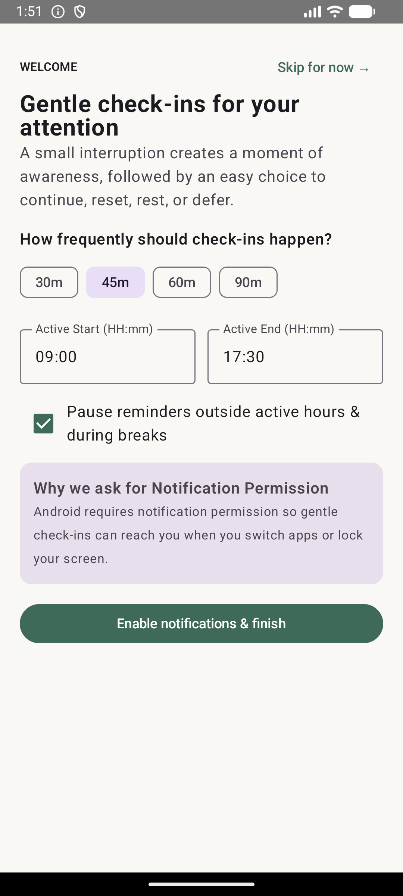
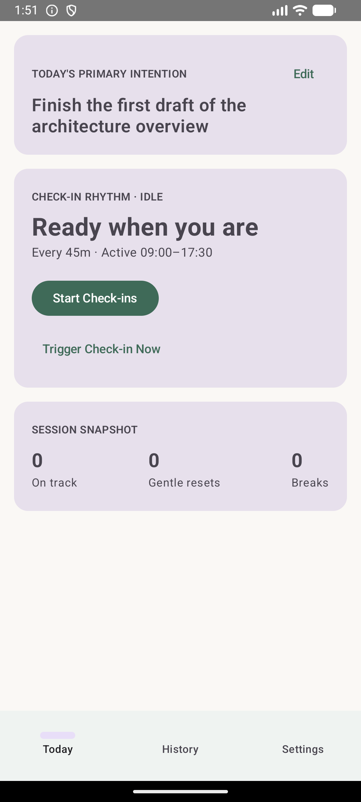
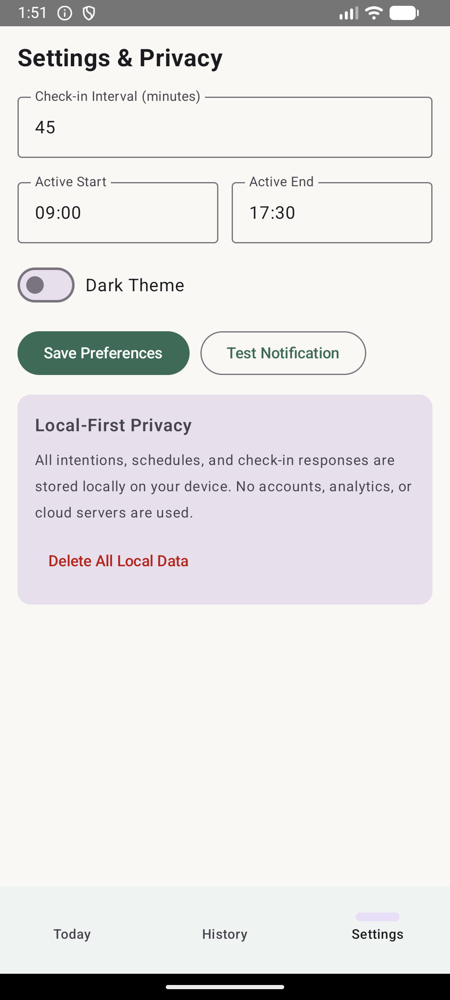

# Back On Track 🎯

A mindful native Android companion app built with modern Jetpack Compose that keeps you focused on your core daily intentions through gentle, periodic check-ins.

---

## 📸 Preview

| Onboarding | Today Screen | Settings |
|:---:|:---:|:---:|
|  |  |  |

---

## ✨ Features

- **Intention Anchoring**: Define your primary intention, secondary tasks, and next small step for each day.
- **Gentle Periodic Check-Ins**: Configurable intervals (e.g. every 15, 30, 45, or 60 minutes) to prompt your state of focus.
- **Smart Active Hours Scheduling**: Automatically pauses notifications outside your chosen schedule (e.g. 09:00 – 17:30) and on weekends, rolling forward cleanly into the next active morning.
- **Interactive Notification Actions**: Quick responses directly from notification shade (`On track`, `Gentle reset`, `Intentional break`, `Snooze`).
- **Resilient Background Execution**: Exact alarm triggers via `AlarmManager` with automatic rescheduling on device boot, package update, and time zone changes.
- **Check-In History**: Review your session logs and response patterns over time.
- **100% Native & Modern**: Built with Jetpack Compose, Material 3, Coroutines, and AndroidX libraries.

---

## 🏗️ Project Architecture & Structure

```
back-on-track/
├── .github/
│   └── workflows/
│       └── build-apk.yml         # CI workflow running unit tests & APK build
├── app/
│   ├── build.gradle.kts          # Module configuration, Compose & dependencies
│   ├── proguard-rules.pro        # ProGuard optimization rules
│   └── src/
│       ├── main/
│       │   ├── AndroidManifest.xml
│       │   ├── java/com/yougaindra/backontrack/
│       │   │   ├── MainActivity.kt                      # Jetpack Compose UI & screens
│       │   │   ├── core/
│       │   │   │   ├── AlarmAndNotificationCoordinator.kt # Exact alarms & notification channels
│       │   │   │   ├── LocalStore.kt                     # SharedPreferences JSON persistence
│       │   │   │   └── SchedulerEngine.kt                # Time calculation, hours & rollover logic
│       │   │   ├── model/
│       │   │   │   └── DomainModels.kt                   # Domain entities, enums & states
│       │   │   └── receiver/
│       │   │       ├── BootAndTimeReceiver.kt            # Re-registers alarms on boot/clock changes
│       │   │       ├── CheckInAlarmReceiver.kt           # Triggers check-in prompts on alarm fire
│       │   │       └── NotificationActionReceiver.kt     # Handles user button clicks in notifications
│       │   └── res/
│       │       ├── drawable/                             # Vector drawables & notification icons
│       │       └── mipmap-anydpi-v26/                    # Adaptive app launcher icons
│       └── test/
│           └── java/com/yougaindra/backontrack/core/
│               └── SchedulerEngineTest.kt                # Unit tests for interval & rollover calculations
├── docs/
│   └── screenshots/              # App UI preview screenshots
├── gradle/
│   └── wrapper/
│       ├── gradle-wrapper.jar
│       └── gradle-wrapper.properties
├── build.gradle.kts              # Root build configuration
├── gradle.properties             # JVM args and AndroidX flags
├── gradlew                       # Linux / macOS Gradle wrapper
├── gradlew.bat                   # Windows Gradle wrapper
├── logo.svg                      # Brand vector logo
├── settings.gradle.kts           # Plugin & repository settings
└── README.md
```

---

## 🚀 Building & Testing

### Prerequisites
- JDK 17 (or newer)
- Android SDK (API 34)

### Run Unit Tests
```bash
./gradlew testDebugUnitTest
```

### Build Debug APK
```bash
./gradlew assembleDebug
```
The output APK will be generated at:
`app/build/outputs/apk/debug/app-debug.apk`

---

## 🤖 Continuous Integration

GitHub Actions workflow (`.github/workflows/build-apk.yml`) automatically runs on every push to `master` or `main`:
1. Sets up JDK 17 & Gradle 8.7
2. Runs unit test suite (`gradle testDebugUnitTest`)
3. Assembles the debug APK (`gradle assembleDebug`)
4. Uploads the debug APK as a downloadable GitHub Action build artifact (`back-on-track-debug-apk`)
